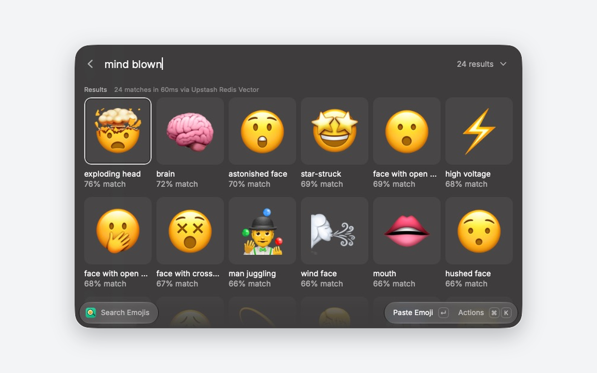

# Emoji Finder

A Raycast extension that finds an emoji from a description. Type "deploying code on friday" or "server on fire", and the best match is selected; press Enter to paste it into the app you were using.



## How search works

Every keystroke updates the grid from a local word matcher (`src/lexical.ts`) over the 1,870 bundled emojis. Words shorter than 3 letters match only exact emoji names, so a partial word like "mi" keeps the current grid instead of showing noise.

70ms after the last keystroke, the extension runs a semantic search and replaces the grid with its results:

1. Embeds the query with OpenAI `text-embedding-3-small` (1536 dimensions).
2. Runs `VECTOR.QUERY text2emoji TOPK <n> BASE64-FP32 <embedding>` on Upstash Redis, fetching 4x the requested count (at most 100).
3. Keeps the best of each set of gendered variants (man, woman, and person technologist count once) and at most one clock face, unless the query mentions a time.

A newer keystroke cancels the in-flight request. Nothing is cached. The section subtitle shows the measured `VECTOR.QUERY` latency.

Vector indexes store only an ID and a vector. Each emoji is its own ID, and names and descriptions ship in `src/emojis.ts`, so a search is one embedding request and one Redis command.

## Actions

| Action | Shortcut |
| --- | --- |
| Paste Emoji | ↵ |
| Copy Emoji | ⌘ ↵ |
| Copy Emoji Name & Description | ⌘ ⇧ C |

The top-left result is selected every time the results change, so Enter pastes the best match. The dropdown in the search bar sets how many results to show (12, 24, or 48).

## Setup

Without configuration, the command shows word matches only. For semantic search, set one of these in the extension preferences:

- **Direct:** Upstash Redis REST URL, Upstash Redis REST Token (read-only is enough), and OpenAI API Key. Raycast calls OpenAI and Upstash directly.
- **Proxy:** Search Proxy URL, a server you run that keeps the keys. The extension sends `GET <proxy>/api/search-emojis?q=<query>&topK=<n>` and expects:

  ```json
  {
    "emojis": ["🤯", "🧠"],
    "results": [{ "emoji": "🤯", "score": 0.76 }, { "emoji": "🧠", "score": 0.72 }],
    "latencyMs": 31
  }
  ```

  `results` and `latencyMs` are optional. Without `results`, tiles show no match percentage.

If both are set, the direct credentials win.

## Seed the index

Create an Upstash Redis database, then put a read-write token and an OpenAI key in `.env` at the repository root (it is gitignored):

```bash
UPSTASH_REDIS_REST_URL=https://your-database.upstash.io
UPSTASH_REDIS_REST_TOKEN=...
OPENAI_API_KEY=...
```

```bash
npm install
npm run seed
```

`scripts/seed.mjs` runs `VECTOR.CREATE text2emoji DIM 1536 METRIC COSINE EXISTSOK`, embeds all emojis in batches of 200 (10 requests), and writes each with `VECTOR.ADD`. Embeddings are cached in `.cache/embeddings.json` by text, so a re-run embeds only entries whose text changed. Writes are upserts, so re-seeding is safe.

## Data

- `data/emoji_data.json`: 1,870 emojis with a name and a generated visual description.
- `data/emoji_enrichment.json`: usage phrases for emojis whose meaning in practice differs from how they look, such as "launch day" for 🚀 or "fingers crossed for the release" for 🤞.

Each emoji is embedded as its name, its description, and any usage phrases. Clock faces are embedded literally ("Analog clock face showing 6:30") so they don't match queries about night or late hours.

After editing either file, run `npm run build:emojis` to regenerate `src/emojis.ts`, then `npm run seed`.

## Development

```bash
npm install
npm run dev     # ray develop
npm run build   # ray build
npm run lint    # ray lint
```

## License

MIT
